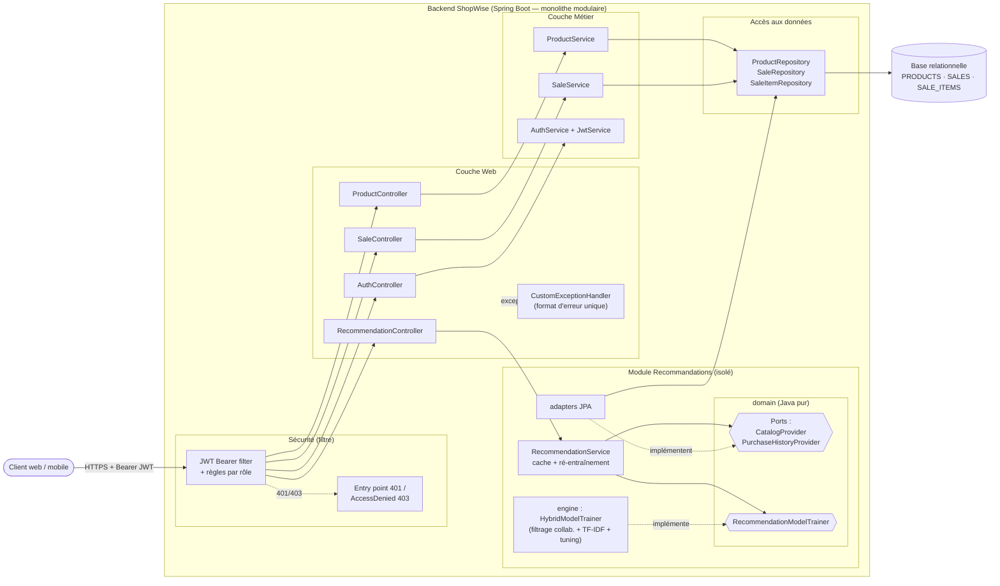
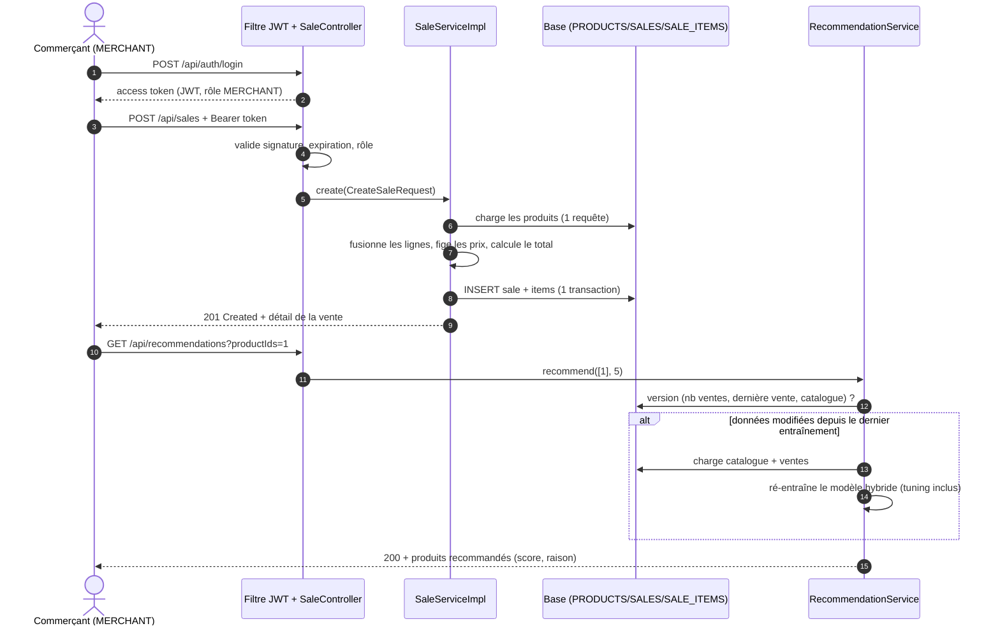
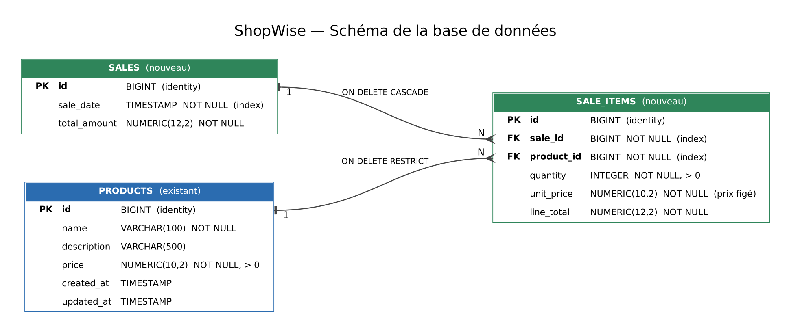
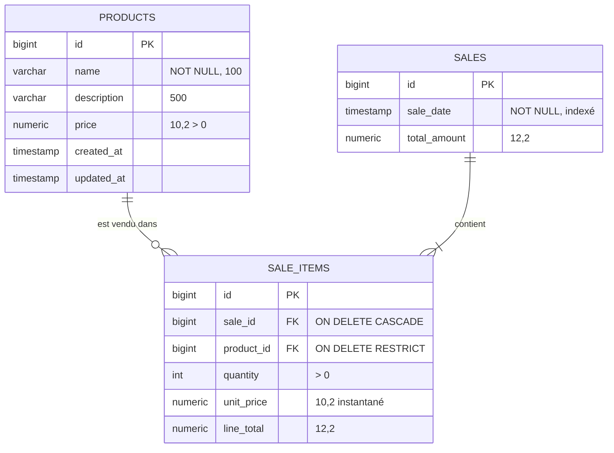

# ShopWise — Backend (Conception avancée)

API REST (Java 21, Spring Boot 4, base relationnelle H2/JPA) pour commerces de proximité :
**catalogue produits**, **ventes**, **recommandations (ML)**, le tout **sécurisé par JWT**.

| | |
|---|---|
| Build + tests + couverture | `mvn verify` (rapport JaCoCo dans `couverture/backend/index.html`) |
| Lancer l'API | `mvn spring-boot:run` → http://localhost:8080 |
| Lancer avec données de démo (produits + 19 ventes) | `mvn spring-boot:run -Dspring-boot.run.profiles=demo` |
| Docker | `docker build -t shopwise . && docker run -p 8080:8080 -e SHOPWISE_JWT_SECRET=<32+ car.> shopwise` |
| Docker Compose | `docker compose up --build` |

Comptes de démonstration (à remplacer en production, voir §3) :

| Utilisateur | Mot de passe | Rôle |
|---|---|---|
| `admin` | `admin123` | `ADMIN` |
| `marie` | `marie123` | `MERCHANT` |
| `clerk` | `clerk123` | `USER` |

Démarrage rapide :

```bash
TOKEN=$(curl -s -X POST localhost:8080/api/auth/login -H 'Content-Type: application/json' \
        -d '{"username":"marie","password":"marie123"}' | jq -r .accessToken)

curl -s localhost:8080/api/products -H "Authorization: Bearer $TOKEN"
curl -s -X POST localhost:8080/api/sales -H "Authorization: Bearer $TOKEN" -H 'Content-Type: application/json' \
     -d '{"items":[{"productId":1,"quantity":2},{"productId":4,"quantity":1}]}'
curl -s "localhost:8080/api/recommendations?productIds=1&limit=3" -H "Authorization: Bearer $TOKEN"
```

Arborescence du dépôt :

```
bdd/                 schema base de données.pdf, script.sql (DDL + données)
couverture/          backend/ (rapport JaCoCo)
src/main/java/...    code source (voir §1.2)
src/test/java/...    tests unitaires, intégration, API, non-régression
Dockerfile           build multi-étapes (tests inclus) + image JRE non-root
readme.md            ce document
```

---

## 1. Architecture cible (Q1 — C.14)

### 1.1 Exigences et attributs de qualité

| Exigence (énoncé) | Conséquence d'architecture |
|---|---|
| SaaS multi-commerces / multi-utilisateurs, **scalabilité** | API **stateless** (JWT, pas de session serveur) → scalable horizontalement derrière un load-balancer ; état uniquement en base |
| **RGPD** (données clients) | Aucune donnée personnelle client stockée aujourd'hui (ventes anonymes) ; secrets hors code (variables d'environnement) ; accès aux ventes limité aux rôles métier ; point d'extension clair pour ajouter un client sans casser l'historique |
| Faible coût, simplicité | Monolithe **modulaire** (un seul déployable), base relationnelle standard, aucune infrastructure ML dédiée |
| **Évolutivité** (US 8) | Modules découplés par des **ports** (interfaces) ; algorithme de reco remplaçable par simple déclaration d'un bean |
| **Robustesse** | Validation en entrée, erreurs normalisées, intégrité référentielle en base, transactions, instantané des prix |
| **Testabilité** | Domaine/ML sans dépendance Spring, injection par constructeur, `Clock` injectable, tests à 4 niveaux |

### 1.2 Responsabilités des modules

| Module (package `com.shopwise.app...`) | Responsabilité | Dépend de |
|---|---|---|
| `controller` (`Product`, `Sale`, `Auth`) | Adaptation HTTP : routage, validation `@Valid`, codes de retour. **Aucune logique métier** | `service`, `dto` |
| `service` (`ProductService`, `SaleService`) | Règles métier et transactions : calcul des totaux, fusion des lignes, instantané des prix, refus de supprimer un produit vendu | `repository`, `mapper` |
| `repository` | Accès aux données (Spring Data JPA), requêtes avec `EntityGraph` (pas de N+1) | `entity` |
| `entity` / `mapper` / `dto` | Modèle persistant / conversions / contrat d'API. Les entités JPA ne sont **jamais** exposées | — |
| `security` + `config.SecurityConfig` | Authentification (login → JWT HS256), autorisation par rôle, normalisation des 401/403 | — |
| `exception` | `@RestControllerAdvice` : un format d'erreur unique pour toute l'API | — |
| `recommendation.domain` | **Cœur du module reco** : modèle (`CatalogItem`, `Basket`, `ScoredProduct`), ports (`CatalogProvider`, `PurchaseHistoryProvider`), contrats (`RecommendationModel`, `RecommendationModelTrainer`). Java pur | — |
| `recommendation.engine` | Algorithme ML (hybride item-kNN) + tuning. Java pur, sans Spring ni JPA | `domain` |
| `recommendation.service` | Orchestration : (ré)entraînement automatique, cache, validation des paramètres | `domain` |
| `recommendation.adapter` | Implémentations JPA des ports : lisent `PRODUCTS`, `SALES`, `SALE_ITEMS` | `domain`, `repository` |
| `recommendation.web` | Endpoint REST des recommandations | `service` |

**Règle de dépendance** : `engine` et `domain` ne connaissent ni Spring, ni JPA, ni HTTP. Seuls les `adapter` connaissent la persistance. Le module reco ne dépend du module Ventes **que via** l'adaptateur `JpaPurchaseHistoryProvider` (un seul point de couplage, remplaçable).

### 1.3 Diagramme de composants



### 1.4 Flux principaux



### 1.5 Justification des choix

**Monolithe modulaire plutôt que micro-services.** Équipe réduite, budget faible (énoncé) : un seul déployable, une seule base, pas de latence réseau ni de transactions distribuées. Les frontières de modules sont néanmoins strictes (ports, packages) : extraire `recommendation` en service autonome serait mécanique (il ne dépend que de deux interfaces).

*Évolutivité*
- **Stateless** (JWT) : N instances identiques derrière un load-balancer, aucune affinité de session.
- **Ports & adaptateurs** pour la reco (US 8) : nouvelle source de données (CSV, entrepôt, Kafka) = nouvelle classe implémentant `PurchaseHistoryProvider` ; nouvel algorithme = nouveau bean `RecommendationModelTrainer`. Le contrôleur, le service et les tests de contrat ne changent pas.
- **Multi-commerces** : le schéma s'étend par une colonne `shop_id` sur `SALES` / `PRODUCTS` et un claim `shop` dans le JWT (aucune table n'a de dépendance forte à un commerçant unique).
- Base : H2 en dev, **script SQL ANSI** (`bdd/script.sql`) compatible PostgreSQL ; passer en base persistante = changer l'URL JDBC et le driver.
- Index sur `sale_date` (tri US 2), `sale_items.sale_id` et `sale_items.product_id` (jointures, entraînement ML).

*Robustesse*
- Validation Bean Validation en entrée (quantité 1..10 000, liste non vide, prix > 0) ; contraintes `NOT NULL`/`CHECK`/`FK` en base (défense en profondeur).
- **Une exception → un code HTTP → un JSON** (`CustomExceptionHandler`) ; plus aucune 500 « fuite » (ex. suppression d'un produit déjà vendu → **409** au lieu d'une erreur SQL).
- Création d'une vente **atomique** (une transaction), total calculé **côté serveur** (jamais fait confiance au client), prix unitaire **figé** à la vente.
- Requêtes `EntityGraph` : pas de N+1 ; le modèle de reco est **immuable** et publié atomiquement (`volatile`) → aucune lecture partielle pendant un ré-entraînement.
- Secret JWT validé au démarrage (≥ 32 octets) : l'application refuse de démarrer avec une clé faible.

*Testabilité*
- Injection par constructeur partout ; `Clock` injecté (dates déterministes) ; moteur ML en Java pur (testé sans contexte Spring, en millisecondes).
- Les ports permettent de tester l'orchestration de la reco avec des fournisseurs en mémoire.
- Chaîne de filtres de sécurité réelle dans les tests d'API : les 401/403 sont testés de bout en bout, pas simulés.

### 1.6 Limites connues et évolutions prévues

| Limite | Évolution |
|---|---|
| Matrices de similarité denses O(N²) : adapté à quelques milliers de produits (commerce de proximité) | Voisins top-K (listes creuses), puis ANN / calcul distribué (Spark) |
| Annuaire utilisateurs en mémoire (démo) | `UserDetailsService` adossé à une table `USERS` ou IdP OIDC (Keycloak) — la configuration resource-server reste identique |
| Ré-entraînement synchrone à la première requête après une vente | Ré-entraînement asynchrone / planifié, modèle persisté |

---

## 2. Évolution du logiciel : module Ventes (Q2 — C.15)

### 2.1 Analyse de l'existant

Architecture en couches déjà propre (controller → service (interface + impl) → repository, DTO + MapStruct, `@ControllerAdvice`). Le module Ventes **reprend exactement ces conventions** (mêmes packages, mêmes suffixes) pour qu'un tiers retrouve ses repères :

- Modifications de l'existant : `ProductServiceImpl.delete` (refus 409 si produit vendu), `ProductRepository` (+1 requête de version), `CustomExceptionHandler` (format normalisé — voir §3).
- Aucune modification du contrat JSON des produits ; les tests de non-régression le prouvent (§5).

### 2.2 Schéma de la base de données



(PDF : `bdd/schema base de données.pdf` · DDL : `bdd/script.sql`)



Décisions de modélisation :
- **`SALES` / `SALE_ITEMS`** (agrégat ticket + lignes) : une vente contient plusieurs produits (US 1), la cascade supprime les lignes avec la vente.
- **`unit_price` figé** : changer le prix du catalogue ne réécrit pas le chiffre d'affaires passé (testé).
- **`line_total` et `total_amount` stockés** (dénormalisation volontaire) : lecture du chiffre d'affaires sans recalcul, valeurs historiques stables. Ils sont **toujours calculés par le serveur**.
- **`ON DELETE RESTRICT`** sur le produit : on ne perd jamais l'historique ; l'API traduit en **409 Conflict**.
- `BigDecimal` / `NUMERIC` pour tous les montants (jamais de flottants).

### 2.3 API Ventes

| US | Méthode / URL | Rôle requis | Réponse |
|---|---|---|---|
| 1 | `POST /api/sales` `{"items":[{"productId":1,"quantity":2}]}` | ADMIN, MERCHANT | `201` + `Location` + détail (lignes, total calculé) |
| 2 | `GET /api/sales` | ADMIN, MERCHANT | `200` liste triée **date décroissante** (id décroissant en départage) : `id, saleDate, totalAmount, itemCount` |
| 3 | `GET /api/sales/{id}` | ADMIN, MERCHANT | `200` lignes (`productId, productName, quantity, unitPrice, lineTotal`) + total ; `404` `"Sale not found with id X"` |

Règles : doublons de produit fusionnés (quantités additionnées) ; produit inconnu → `400` listant les ids ; quantité hors 1..10 000 ou liste vide → `400` avec détail par champ.

### 2.4 Principes SOLID appliqués

- **S** : controller (HTTP) / service (métier) / mapper (conversion) / repository (persistance) ont chacun une seule raison de changer.
- **O** : ajouter une source ou un algorithme de reco = ajouter une classe, sans modifier l'existant.
- **L** : toute implémentation de `RecommendationModelTrainer` / `PurchaseHistoryProvider` est substituable (contrats testés via les interfaces).
- **I** : ports étroits (`CatalogProvider`, `PurchaseHistoryProvider`) plutôt qu'un accès générique au dépôt.
- **D** : `RecommendationService` dépend d'abstractions du domaine ; les adaptateurs JPA dépendent du domaine, pas l'inverse.

---

## 3. Sécurisation de l'API (Q3 — C.16)

### 3.1 Opérations sensibles identifiées

| Opération | Sensibilité | Politique |
|---|---|---|
| Créer / modifier un produit | Intégrité du catalogue et des prix | ADMIN, MERCHANT |
| Supprimer un produit | Destructif | ADMIN seul |
| Créer une vente | Intégrité du chiffre d'affaires | ADMIN, MERCHANT |
| Lire les ventes (CA) | Confidentialité commerciale | ADMIN, MERCHANT |
| Recommandations (dérivées des ventes) | Confidentialité commerciale | ADMIN, MERCHANT |
| Ré-entraîner le modèle | Coût de calcul | ADMIN seul |
| Lire le catalogue | Faible | tout utilisateur authentifié |
| Login | Point d'entrée | public (seule route publique) |

### 3.2 Mécanisme retenu : JWT signé (HS256) + Spring Security resource server

- `POST /api/auth/login` vérifie le mot de passe (**BCrypt**) et émet un **access token JWT** (`sub`, `roles`, `iat`, `exp` = 1 h).
- Chaque requête porte `Authorization: Bearer <token>` ; le filtre Spring Security valide **signature + expiration** puis transforme le claim `roles` en autorités `ROLE_*`.
- Les règles d'accès sont **centralisées** dans `SecurityConfig` (matrice lisible en un coup d'œil) ; **tout ce qui n'est pas explicitement listé exige au minimum une authentification** (deny par défaut).

| Réponse | Cas | Source |
|---|---|---|
| **401** | token absent / invalide / falsifié / expiré, mauvais identifiants | `RestAuthenticationEntryPoint`, `AuthService` |
| **403** | token valide mais rôle insuffisant | `RestAccessDeniedHandler` |

### 3.3 Justification des choix

| Choix | Pourquoi (et alternatives écartées) |
|---|---|
| **JWT stateless** plutôt que session HTTP | Cohérent avec la scalabilité horizontale exigée : aucun stockage de session partagé, utilisable par web **et** mobile. Session + cookie écartés (CSRF, affinité). |
| **Resource server Spring Security** plutôt qu'un filtre maison | Code de sécurité éprouvé et maintenu : validation de signature, d'expiration, gestion des en-têtes. On ne réinvente pas la cryptographie. |
| **HS256 (clé symétrique)** | Un seul service émet **et** valide : plus simple et moins coûteux que RSA/JWKS. Si un IdP externe (Keycloak, Auth0) est introduit, on passe à RS256 en changeant uniquement le `JwtDecoder` (point d'extension identique). |
| **Rôles dans le token** (`ADMIN`, `MERCHANT`, `USER`) | Autorisation sans requête en base à chaque appel ; principe du **moindre privilège** (USER = lecture catalogue seule). |
| **BCrypt** | Hachage adaptatif salé ; aucun mot de passe en clair en mémoire applicative ni dans les logs. |
| **Même message** « Invalid credentials » pour utilisateur inconnu / mauvais mot de passe | Évite l'énumération de comptes. |
| **CSRF désactivé** | Légitime ici : API sans cookie d'authentification (le token est dans un en-tête explicite, non envoyé automatiquement par le navigateur). |
| **Secret JWT et mots de passe par variables d'environnement** (`SHOPWISE_JWT_SECRET`, …) ; clé < 32 octets refusée au démarrage | Pas de secret versionné ; échec rapide plutôt qu'une sécurité dégradée silencieuse. |
| **Console H2 désactivée par défaut** | Elle donnerait un accès base non authentifié, hors du périmètre JWT. |
| Écriture des 401/403 dans le filtre au **même format JSON** | Ces erreurs surviennent avant le `DispatcherServlet` : `@ControllerAdvice` ne les voit pas, il faut donc des handlers dédiés pour rester cohérent (US 6). |

Hors périmètre de l'étude de cas, à prévoir en production : HTTPS terminé par le reverse-proxy, refresh tokens / révocation, limitation de débit sur `/login`, table `USERS` persistante, journal d'audit (la traçabilité de l'US 5 s'appuie sur le `sub` du token).

### 3.4 Normalisation des erreurs (US 6)

Toutes les erreurs ont la même forme :

```json
{
  "timestamp": "2026-10-22T10:15:30.123Z",
  "code": 404,
  "error": "NOT_FOUND",
  "message": "Sale not found with id 42",
  "path": "/api/sales/42",
  "details": []
}
```

| HTTP | `error` | Déclencheur |
|---|---|---|
| 400 | `VALIDATION_ERROR` (+ `details[{field,message}]`), `MALFORMED_REQUEST`, `BAD_REQUEST` | payload invalide, JSON illisible, paramètre mal typé, produit inconnu dans une vente |
| 401 | `UNAUTHORIZED` | pas / mauvais token, mauvais identifiants |
| 403 | `FORBIDDEN` | rôle insuffisant |
| 404 | `NOT_FOUND` | ressource ou route inexistante |
| 405 / 415 | `METHOD_NOT_ALLOWED` / `UNSUPPORTED_MEDIA_TYPE` | méthode ou type de contenu non supporté |
| 409 | `CONFLICT` | suppression d'un produit déjà vendu |
| 500 | `INTERNAL_ERROR` | erreur inattendue (détail **loggé**, jamais renvoyé au client) |

> Changement de contrat assumé : l'ancien handler renvoyait du texte brut (404) ou une map `champ → message` (400). Les clients doivent lire `message` / `details`. Les tests de non-régression ont été adaptés en conséquence ; les **codes HTTP** historiques sont inchangés.

---

## 4. Module de recommandations / ML (Q4 — C.18)

### 4.1 Périmètre fonctionnel

- **Données exploitées** : les **ventes** (chaque vente = un panier de produits, quantités incluses) **et** le **catalogue** (nom, description, prix) — conformément à l'US 7.
- **Recommandations produites** :
  1. **Produits associés à un panier** (« souvent achetés avec… » + produits de même nature) : `GET /api/recommendations?productIds=1,2&limit=5`
  2. **Meilleures ventes** quand aucun produit de référence n'est fourni : `GET /api/recommendations?limit=5`
- `limit` : 1..20 (défaut 5). Réponse :

```json
{
  "basis": [1],
  "strategy": "HYBRID_ITEM_KNN",
  "model": { "algorithm": "hybrid-item-knn (cosine co-purchase + TF-IDF content)", "trainedAt": "...",
             "productCount": 9, "basketCount": 19, "collaborativeWeight": 0.6, "tuned": true, "validationHitRate": 0.83 },
  "recommendations": [
    { "productId": 5, "name": "AirPods Pro", "price": 279.00, "score": 0.7312, "reason": "SIMILAR_TO_BASKET" }
  ]
}
```

- `POST /api/recommendations/retrain` (ADMIN) force un ré-entraînement ; il est sinon **automatique** dès qu'une vente est ajoutée ou que le catalogue change (empreinte de version comparée à chaque requête).

### 4.2 Algorithme : filtrage item-item hybride (apprentissage non supervisé + optimisation)

Pour deux produits *i* et *j*, la similarité apprise est :

```
sim(i, j) = w · collab(i, j) + (1 − w) · contenu(i, j)
```

**a) Composante collaborative (apprise des ventes)** — cosinus sur la matrice binaire ventes × produits :

```
collab(i, j) = co(i, j) / √( n_i · n_j )
```
`n_i` = nombre de ventes contenant *i* ; `co(i,j)` = nombre de ventes contenant *i* et *j*. Valeur dans [0,1] : 1 si les deux produits ne sont jamais vendus l'un sans l'autre. La normalisation par √(n_i·n_j) évite que les best-sellers soient recommandés pour tout le monde.

**b) Composante contenu (issue du catalogue)** — traite le **démarrage à froid** (nouveaux produits jamais vendus) :

```
contenu(i, j) = 0,8 · cos(TF-IDF(nom + description)_i , TF-IDF(...)_j) + 0,2 · (1 − |p_i − p_j| / max(p_i, p_j))
```
Texte normalisé (minuscules, accents retirés, mots vides FR/EN retirés), pondération TF-IDF lissée `idf = ln((1+N)/(1+df)) + 1`, vecteurs L2-normalisés ; le second terme est une proximité de prix.
Si l'un des deux produits n'a **jamais été vendu**, `w` est forcé à 0 : on bascule sur le contenu seul.

**c) Score pour un panier S** (plusieurs produits de référence) : moyenne des similarités, produits du panier exclus :

```
score(j | S) = (1/|S|) · Σ_{s∈S} sim(s, j)      puis tri décroissant (départage : popularité, puis id)
```

**d) Optimisation du poids `w` (apprentissage supervisé léger)** : au lieu d'un `w` arbitraire, le modèle le **choisit sur les données** :
1. Découpage **temporel** : 80 % des ventes les plus anciennes pour entraîner, 20 % les plus récentes pour valider (pas de fuite du futur).
2. Pour chaque vente de validation (≥ 2 produits), on retire un produit, on recommande à partir des autres, on vérifie s'il est dans le **top-k** (*hit-rate@k*, k = 5).
3. Recherche sur grille `w ∈ {0, 0.1, …, 1}` ; on garde le meilleur (égalité → le plus proche du défaut 0,6).
4. Le modèle final est ré-entraîné sur **toutes** les ventes avec ce `w`.
Si moins de 5 ventes de validation exploitables : pas de tuning, `w = 0,6` (`"tuned": false`).

**e) Meilleures ventes** (aucun produit de référence) : popularité = Σ quantités vendues, normalisée par le maximum (score ∈ [0,1]).

**Pourquoi cet algorithme ?**

| Critère | Choix |
|---|---|
| Petites données d'une boutique (quelques centaines de ventes) | Les réseaux de neurones / factorisation matricielle sur-apprennent et exigent beaucoup de données ; le kNN item-item fonctionne dès quelques dizaines de ventes |
| Démarrage à froid | La composante contenu garantit une réponse sensée sans historique |
| Explicabilité pour un commerçant | « Recommandé car acheté avec X dans N ventes » ; le score est une similarité lisible |
| Coût | Entraînement en quelques millisecondes à quelques centaines de ms ; aucune infra GPU/ML |
| Pas de dépendance lourde | Implémentation directe en Java (pas de bibliothèque externe à maintenir) |

### 4.3 Architecture modulaire et pistes d'amélioration (US 8)

Le module est isolé (`com.shopwise.app.recommendation`). Pour le faire évoluer :

| Besoin | Où intervenir |
|---|---|
| Nouvelle source de données (CSV, entrepôt, flux) | Implémenter `PurchaseHistoryProvider` / `CatalogProvider` |
| Meilleur algorithme | Implémenter `RecommendationModelTrainer` + `RecommendationModel`, déclarer le bean (`@Primary`) |
| Hyperparamètres | `HybridConfig` (poids par défaut, k, ratio de validation) |

Pistes d'amélioration : pondérer par la **récence** (décroissance exponentielle) et les **quantités** ; ajouter une catégorie produit au contenu ; **factorisation matricielle implicite (ALS)** ou **embeddings** dès que le volume le justifie ; voisinages creux top-K + index ANN pour grands catalogues ; **personnalisation par client** (après consentement RGPD) ; évaluation hors-ligne continue (hit-rate, NDCG) exposée en métrique ; ré-entraînement asynchrone et modèle persisté.

---

## 5. Stratégie de tests (Q5 — C.17)

### 5.1 Pyramide de tests

| Niveau | Outils | Ce qui est vérifié | Classes |
|---|---|---|---|
| **Unitaires** (rapides, sans Spring) | JUnit 5, Mockito, AssertJ | Règles métier : total, fusion de lignes, prix figé, erreurs 404/400/409 ; moteur ML (cosinus, TF-IDF, classement, démarrage à froid, tuning) ; JWT (émission, expiration, signature falsifiée, clé faible) ; login | `ProductServiceImplTest`, `SaleServiceImplTest`, `JwtServiceTest`, `AuthServiceTest`, `JsonErrorWriterTest`, `TextVectorizerTest`, `HybridModelTrainerTest`, `RecommendationServiceTest` |
| **Intégration (persistance)** | `@SpringBootTest` + H2, transactions annulées | Mapping JPA, cascade, tri US 2, `EntityGraph`, requêtes personnalisées | `SaleRepositoryIT` |
| **API (bout en bout HTTP)** | MockMvc + **chaîne de filtres de sécurité réelle** + vrais JWT + H2 | Contrats REST de chaque US, codes HTTP, format d'erreur, 401/403 par rôle, recommandations à partir de vraies ventes | `AuthApiIT`, `SecurityApiIT`, `SaleApiIT`, `RecommendationApiIT` |
| **Non-régression** | idem API | Le catalogue historique garde son contrat JSON et ses codes HTTP | `ProductApiRegressionIT` + `ProductServiceImplTest` |
| Démarrage | `@SpringBootTest` | Le contexte (JPA, sécurité, modules) se charge | `AppApplicationTests` |

### 5.2 Non-régression

- `ProductApiRegressionIT` rejoue le comportement **historique** : jeu de données `data.sql` toujours chargé, contrat JSON d'un produit (`id, name, description, price, createdAt, updatedAt`), `201` à la création, mise à jour, `204`/`404` à la suppression, `404` « Product not found », `400` de validation. Seule l'authentification est ajoutée aux appels (évolution voulue, US 4/5).
- Les tests fixent aussi les **nouvelles règles** (suppression d'un produit vendu → `409`, prix historique figé) pour qu'une future évolution ne les casse pas.
- Les tests d'API nettoient leurs données (`@AfterEach`) : ils sont indépendants de l'ordre d'exécution.

### 5.3 Exécution

```bash
  mvn test                       # tous les tests (unitaires + intégration + API)
  mvn verify                     # idem + rapport de couverture couverture/backend/index.html
  mvn -Dtest='*Test' test        # uniquement les tests unitaires
  mvn -Dtest='*IT' test          # uniquement intégration / API / non-régression
  docker build .                 # le build Docker exécute aussi les tests
```

Couverture : JaCoCo (rapport HTML dans `couverture/backend/`).

---

## 6. Configuration

| Propriété / variable | Défaut | Rôle |
|---|---|---|
| `SHOPWISE_JWT_SECRET` | secret de dev | Clé HS256 (≥ 32 caractères) — **à définir en production** |
| `shopwise.security.jwt.ttl-seconds` | `3600` | Durée de vie du token |
| `SHOPWISE_ADMIN_PASSWORD`, `SHOPWISE_MERCHANT_PASSWORD`, `SHOPWISE_CLERK_PASSWORD` | `admin123`, `marie123`, `clerk123` | Mots de passe des comptes de démo |
| `spring.profiles.active=demo` | — | Charge 5 produits et 19 ventes de démonstration |
| `spring.h2.console.enabled` | `false` | Console H2 (dev local uniquement) |
